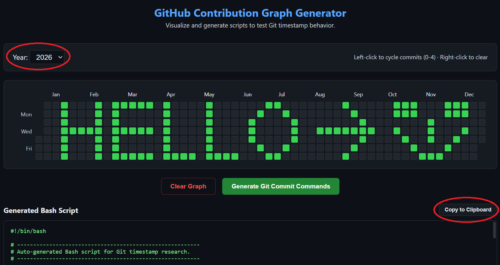
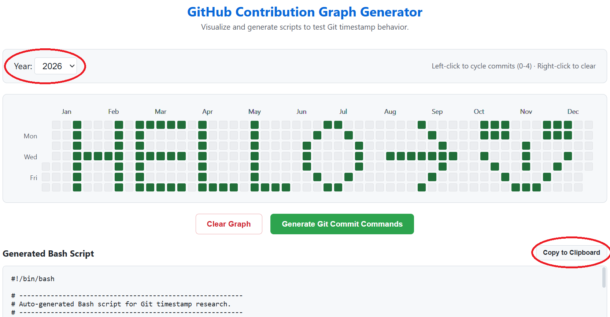

🌐 Language: **English** | [中文](README.zh.md)

# GitHub Contribution Graph Simulator

An educational, open-source web tool designed to study and visually simulate the GitHub contribution graph. 

## Disclaimer

- **This project is created for educational and research purposes only.**

- The primary goal of this tool is to help developers understand the underlying mechanics of how GitHub calculates and displays contribution heatmaps (e.g., how `AuthorDate`, `CommitDate`, timezones, and empty commits are processed). 

- **We do not encourage or endorse the use of this tool for fabricating a fake resume, misleading employers, or artificially inflating a developer's reputation.**

- By using this tool, you agree that you are solely responsible for its usage. We openly invite GitHub Security and Engineering teams to review this project and patch any underlying vulnerabilities in their contribution calculation logic if they deem it necessary.

## Why Fake Commits Fail

Many developers try to generate fake contribution graphs using simple scripts like `git commit --date="..."`. However, they usually fail to show up on the public graph for others. This tool addresses three main failure points:

1. **Empty Commits (`--allow-empty`):** GitHub's public API aggressively filters out commits with zero file diffs.
2. **Timezone Shift:** Specifying a date without a time (or defaulting to `00:00:00`) might shift the contribution block to the previous or next day due to UTC offset calculations.
3. **Dual Timestamps:** Git maintains both `AuthorDate` and `CommitDate`. If they are not synchronized, GitHub's public caching system might ignore the historical date.

## 🛠️ Features

- **Visual Interface:** A clickable 7x53 grid to easily paint and visualize your contribution graph.
- **Right-Click to Clear:** Left-click to cycle commit intensity (0-4), and right-click to instantly clear a specific cell for quick edits.
- **Accurate Month Alignment:** Real-time rendering of month labels that perfectly align and center with the spanned weeks.
- **Smart Script Generation:** Generates highly optimized Bash scripts using native functions and `for` loops, keeping the output concise and readable.
- **Timezone Safe:** Hardcodes `T12:00:00` to the generated dates to safely bypass UTC boundary issues across different platforms.
- **Real Diffs:** Generates scripts that modify a dummy `activity.txt` file, ensuring the commits are counted as "real" contributions by GitHub's public API.
- **Auto Dark/Light Mode:** The user interface automatically adapts to your operating system's color scheme (GitHub Light/Dark themes).
- **One-Click Clear:** Easily reset the entire graph with the "Clear Graph" button to start fresh.

<div align="center">
  
  
</div>

## 🚀 How to Use

1. Clone this repository or download the source files (`index.html`, `style.css`, `app.js`).
2. Open `index.html` in any modern web browser (No local server or Node.js required).
3. Select the target year from the dropdown, **left-click** on the grid to select dates and commit intensity (0 to 4), or **right-click** to quickly clear a cell.
4. Click the **"Generate Git Commit Commands"** button.
5. Click **"Copy to Clipboard"** to copy the generated Bash script.
6. Create a new file named `script.sh` in your local Git repository, paste the copied code, and save it.
7. Run the script in your local Git terminal and push:

```bash
bash script.sh
git push origin main
```

## Contributing

Contributions, issues, and feature requests are welcome! If you find a bug or have an idea to improve the tool, feel free to open an Issue or submit a Pull Request.

## License

This project is [MIT](https://choosealicense.com/licenses/mit/) licensed.